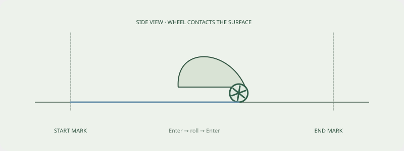
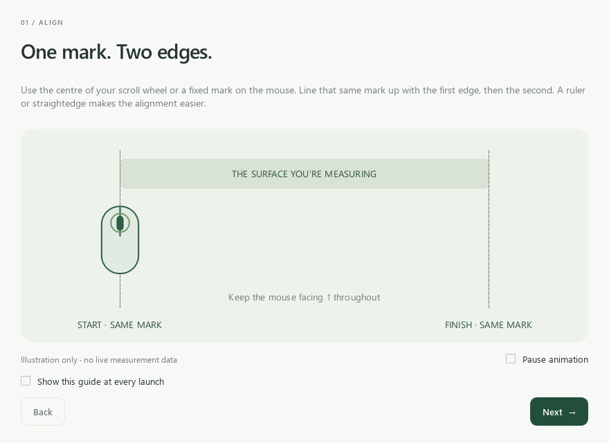

# MouseRuler
### Measure without a ruler. Put your mouse to work.

Turn an ordinary optical mouse into a physical measuring tool. MouseRuler reads
raw sensor movement, bypassing Windows pointer acceleration, to estimate the
distance between two points—even when you take a crooked path.

**[Website & quick guide](https://vivaswann.github.io/MouseRuler/)** · [How to measure without a ruler](https://vivaswann.github.io/MouseRuler/how-to-measure-without-a-ruler.html)

## Quick Start · slide measurement

1. **Enter your mouse’s current DPI.**
2. **Double-left-click** at the starting point.
3. **Slide to the endpoint**, keeping the mouse facing the same direction and flat on the surface.
4. **Double-left-click again** to finish. Read the distance in **mm, cm, metres, or inches**.

**Enter** also starts/finishes · **Escape** cancels · **R** resets.

## New: roll your scroll wheel along an object

Choose **Wheel**, roll once to select your mouse, then **Start → roll → Enter**.
Read the rolled-path estimate in mm, cm, metres, and inches. No mouse DPI or ruler
calibration is required for wheel mode.

**How to roll** opens an animated guide. **Wheel setup** offers device-name
identification, source-linked model hints, a one-turn step counter, and saved
settings. Example dimensions remain clearly labelled as rough estimates;
mouse detection does not establish wheel diameter or physical accuracy.



[Wheel guide and limitations](docs/WHEEL.md) · [Mouse specification sources](docs/MOUSE_PROFILES.md)

## Download & run

**[↓ Download for Windows](https://github.com/vivaswann/MouseRuler/releases/download/v1.4.1/MouseRuler-Windows-1.4.1.zip)**

Extract the ZIP and open `MouseRuler.exe`. **No Python installation required.**
Windows 11 x64 · [Release notes & checksums](https://github.com/vivaswann/MouseRuler/releases/tag/v1.4.1)

## Same mark. Same direction.

Align the centre of the scroll wheel—or another fixed mark—with each edge.
Keep the mouse’s orientation unchanged. The built-in guide walks you through it.



## A crooked path. A straight answer.

- **Direct distance** measures from your start point to your endpoint.
- **Travelled path** shows how far you actually moved.
- **Stay in the flow:** the pointer hides and stays inside the graph while recording.
- **Keep it local:** light/dark themes, JSON exports, and no telemetry.

> **Know the limits:** DPI-based lengths are estimates. Optional ruler calibration
> refines the scale. Don’t rotate or lift the mouse during a measurement;
> neither DPI nor calibration can recover that missing information.

<details>
<summary><strong>Run from source</strong></summary>

```powershell
git clone https://github.com/vivaswann/MouseRuler.git
cd MouseRuler
py -3.13 -m venv .venv
.venv\Scripts\python.exe -m pip install -r requirements-dev.txt
.venv\Scripts\python.exe bootstrap.py
```

</details>

<details>
<summary><strong>Test & build</strong></summary>

```powershell
.venv\Scripts\python.exe -m ruff check .
.venv\Scripts\python.exe -m ruff format --check .
.venv\Scripts\python.exe -m pytest -q
.\build.ps1 -Python .venv\Scripts\python.exe
```

The native cursor test requires an interactive Windows desktop.
Headless runners use `pytest -m "not desktop"`. Executables are unsigned.

</details>

[Full guide](docs/USAGE.md) · [Contribute](CONTRIBUTING.md) · [Validation](docs/VALIDATION.md) · [Changelog](CHANGELOG.md)

**Open source · [MIT license](LICENSE)** · [Third-party notices](THIRD_PARTY_NOTICES.md)
