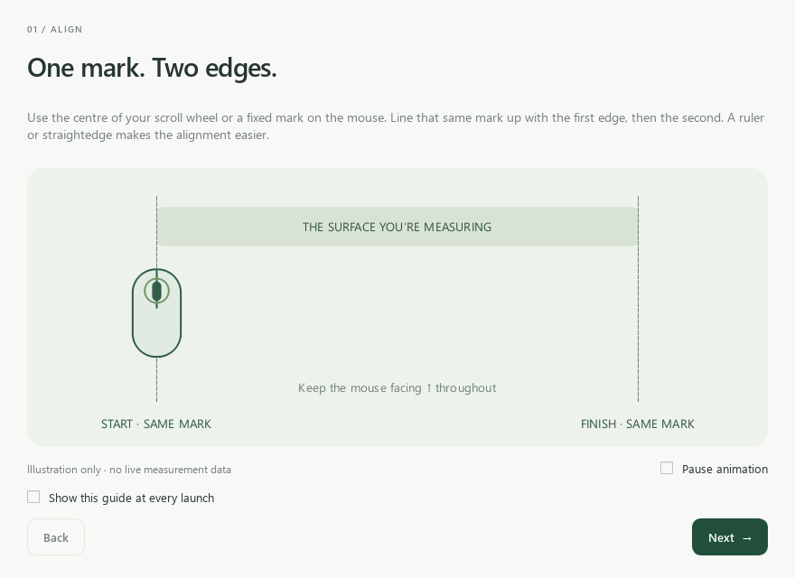
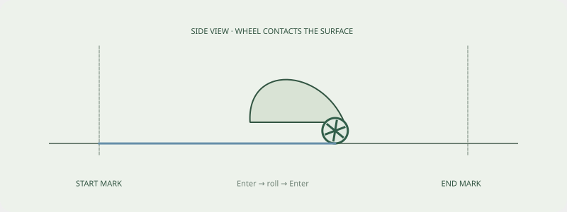

# MouseRuler documentation

[← Back to the project](../README.md)

## Use the app

| Guide | What it covers |
| --- | --- |
| [Slide measurement](USAGE.md) | First measurement, DPI, alignment, optional ruler calibration, controls, and exports. |
| [Wheel measurement](WHEEL.md) | Wheel contact, step counting, saved setup, and how the estimate works. |
| [Accuracy & validation](VALIDATION.md) | What has been checked and what still needs physical testing. |
| [Mouse model information](MOUSE_PROFILES.md) | Manufacturer sources, partial wheel hints, and device-identification limits. |

The app includes animated instructions for both measurement methods. Choose
**Guide** on the relevant tab, or **How to roll** in Wheel mode.

## Develop the project

- [Development guide](DEVELOPMENT.md): installation, tests, builds, and a source map.
- [Contributing](../CONTRIBUTING.md): change guidelines and useful bug reports.
- [Changelog](../CHANGELOG.md): version history.
- [Security policy](../SECURITY.md): reporting security issues.
- [Third-party notices](../THIRD_PARTY_NOTICES.md): dependency licenses.

## See the methods

### Slide: align the same mark at both endpoints

### Wheel: roll with continuous contact

[Download the latest release](https://github.com/vivaswann/MouseRuler/releases/latest)
