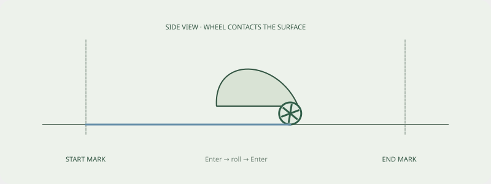

# Measure with the scroll wheel

Open **Wheel**, roll the intended wheel once to select it, and choose **Start wheel
measurement**. Roll the exposed wheel from the start mark to the end mark, stop,
and press **Enter**. Read the rolled-path estimate in mm, cm, metres, and inches.
Escape cancels and R resets. Keep MouseRuler in front while recording.

## Position the mouse

Hold the mouse so the scroll wheel contacts the surface while its casing stays
clear. Align the wheel's contact point with each endpoint. Use light, consistent
pressure and avoid sideways dragging, slipping, and lifting mid-roll. Disable
free-spin, Smart-Reel, or other automatic mode changes. Backtracking adds length;
this is a path measurement, not a 2D endpoint displacement.

**How to roll** opens three animated lessons covering contact, rolling, and common
mistakes. The main **Guide** button opens the wheel guide when Wheel is selected.

## Quick estimate or your own wheel setup

No ruler-reference calibration is required. Initial 24 mm diameter / 24 increments
per revolution values are examples, not detected hardware specifications. They
enable a rough estimate immediately, but do not establish actual physical length.

Expand **Wheel setup** to enter the real outer wheel diameter and reported scroll
increments per turn. **Count one full turn** helps find the latter: with the mouse
lifted, mark a reference on the wheel, start counting, turn exactly one revolution
in one direction, then stop and use the count. This finds rotation increments only,
not diameter. Use the same wheel mode for setup and measurement. Changed settings
save for that device when a measurement starts, or via Save wheel settings.

## Mouse identification and online specifications

Read-only HID product strings may identify a connected model. Generic wireless
receivers often identify only the receiver or vendor, so the app does not infer
which mouse is paired. Identification runs off the UI thread and cannot change
an active measurement's scale. Saved user settings take precedence over hints.

The bundled catalog contains manufacturer-sourced *partial* wheel information for
five Razer models. It does not invent unknown diameters or equate mouse body size
with wheel size. Fixed step hints prefill only the published step count; selectable
modes require checking the current mode. Confirm the number of Raw Input increments
with the one-turn helper. See [sources and coverage](MOUSE_PROFILES.md).

Find wheel specifications online opens your browser using the public model name
or vendor only. MouseRuler performs no background web searches and sends no device
instance paths, serials, saved profiles, or measurement records. No search service
API key is needed; the app and its built-in hints otherwise work offline.

## Calculation and limits

Distance in mm = travelled raw wheel units / 120 × π × diameter in mm /
increments per revolution. Fractional reports accumulate without rounding to full
increments. Positive and negative rotation both add to travelled path length.
Windows reports wheel rotation, not wheel circumference. DPI and optical motion
are excluded from this calculation; horizontal wheel input is ignored.

The scale is frozen when recording starts. Settings edited after finishing do not
retroactively change the result. Unrelated mice cannot add counts while recording.
Focus loss, input changes, errors, and disconnects discard an active partial trace.

Wheel profiles use `wheel-geometry.json` beside the existing settings file; optical
DPI and ruler profiles are unchanged. Earlier local prototype settings under
`.wheel-local-data/` remain separate and are not uploaded or automatically imported.

Slipping, compression, firmware remapping, lost contact, and free-spinning can
invalidate results. Physical accuracy has not been independently characterized.
Use a suitable physical measuring instrument when accuracy matters.
